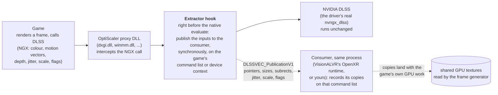

# OptiScaler-DLSSMotionVectorExtractor

**A technical fork of [OptiScaler](https://github.com/optiscaler/OptiScaler) that does one thing: at every DLSS evaluate it hands the game's
DLSS inputs, motion vectors first, to another component running in the same process, through a small C ABI.** It was built for
[VisionALVR](https://github.com/jfbobier/vision-alvr), whose frame generation moves the scene with the game's own vectors instead of
measuring the motion afterwards, and it is written so that any other project can consume the same stream.

This is not a new upscaler mod and not an OptiScaler release. Everything that makes OptiScaler what it is, the upscaler swapping, the frame
generation bridges, the menus, the years of per-game knowledge, is the work of the OptiScaler team. If you use OptiScaler for what OptiScaler
does, go to **[the real project](https://github.com/optiscaler/OptiScaler)**, read its wiki, and if you want to support anyone, support
**them**: [GitHub Sponsors](https://github.com/sponsors/cdozdil?frequency=one-time) · [Buy Me a Coffee](https://buymeacoffee.com/nitec).
Nothing here asks for money and nobody here deserves OptiScaler's credit. GPL-3.0, as upstream; the source of every released DLL is the tagged
commit it is named after.

## What it does



The game's picture is untouched: OptiScaler's DLSS backend still runs NVIDIA's own code. The hook adds a function call per evaluate; with no
consumer registered it costs a few parameter reads. The consumer gets the game's resources and the command list the evaluate is being recorded
on, so its copies are ordered with the game's work and need no fence of their own. OptiScaler keeps nothing, allocates nothing and never blocks.

## The API

One header, `OptiScaler/visionalvr/VaProvider.h`, C ABI, version 1. The extractor module exports two functions; the consumer finds the module by
its export (whatever proxy name the DLL was given) and registers a callback:

```c
uint32_t DLSSVEC_ProviderVersion();                                    // the ABI version this module speaks: 1
int      DLSSVEC_SetConsumerV1(DLSSVEC_ConsumerV1 consumer, void* user);   // register (nullptr removes); 1 on success

typedef void (*DLSSVEC_ConsumerV1)(const DLSSVEC_PublicationV1* publication, void* user);
```

The callback runs synchronously inside every DLSS Super Resolution evaluate, D3D11 and D3D12, with:

| field | meaning |
|---|---|
| `struct_size`, `version` | sizeof the struct, ABI version (1) |
| `api` | 11 = D3D11 (`cmd` is an `ID3D11DeviceContext*`, resources `ID3D11Resource*`), 12 = D3D12 (`ID3D12GraphicsCommandList*`, `ID3D12Resource*`) |
| `stream` | OptiScaler's feature handle: one per DLSS feature, so one per eye in a VR title |
| `frame` | the evaluate counter of that stream |
| `cmd` | the game's command list or device context the evaluate is recorded on: record your copies here, before DLSS runs |
| `color`, `motion_vectors`, `depth`, `output`, `exposure` | the DLSS inputs as the game set them; any may be null |
| `render_w/h`, `output_w/h` | the DLSS input size (render subrect) and the display size |
| `color_x/y`, `mv_x/y`, `depth_x/y` | subrect bases of the inputs |
| `jitter_x/y` | the NGX jitter offset, in render pixels |
| `mv_scale_x/y` | the NGX motion-vector scale |
| `reset` | the game asked for a history reset |
| `flags` | the feature's `NVSDK_NGX_DLSS_Feature_Flags` (MVLowRes, MVJittered, DepthInverted, IsHDR, ...) |
| `params` | the full `NVSDK_NGX_Parameter` object, valid during the call only |

Rules for a consumer, learned the hard way in VisionALVR: do your work on `cmd` and return; never block; copy, do not keep the game's
resources; on D3D12 a shared texture a D3D11 device will open must be created with the render-target and simultaneous-access flags; depth
comes typeless (D32, D32_S8X24) and needs a typed twin; a stream disappears when the game recreates its DLSS feature (resolution change),
so retire your copies rather than destroying them at once. The reference consumer is VisionALVR's `ovrshim/ngxtap.h` (MIT), header-only.

## What changed against upstream

Branch `visionalvr`, upstream source otherwise intact:

- `OptiScaler/visionalvr/VaProvider.{h,cpp}`: the ABI above and the publication built from the NGX parameters.
- Two hook lines in `upscalers/dlss/DLSSFeature_Dx11.cpp` and `DLSSFeature_Dx12.cpp`, right before the native evaluate.
- Compiled defaults so that no `OptiScaler.ini` is needed: DLSS backend on every API, DXGI spoofing off, and the DLL draws nothing in the game
  (`DisableMenu`: no menu, no splash, no toasts; upstream renders them onto the DLSS output inside every evaluate, with barriers of its own on
  the game's command list, a pass that conflicts with VR injectors such as UEVR). An ini next to the
  game still overrides them, exactly as upstream. Without a consumer this DLL behaves like OptiScaler with those defaults.

## Install (VisionALVR users)

1. Download `OptiScaler-DLSSMotionVectorExtractor-<commit>.dll` from this repository's **Releases** page.
2. Copy it next to the game's real executable (Unreal titles: `<Game>\Binaries\Win64\`, where `*-Win64-Shipping.exe` lives) and rename it
   to one of OptiScaler's proxy names: `dxgi.dll` is the usual choice; `winmm.dll`, `version.dll`, `dbghelp.dll`, `winhttp.dll` or
   `wininet.dll` when another mod already owns `dxgi.dll`. One file, no registry change, no ini.
3. The game must run DLSS Super Resolution (any quality mode, DLAA included) for vectors to exist. In VisionALVR's streamer window tick
   **DLSS motion vectors**; the shim log then reads `motion vectors: attached to ...dxgi.dll`, then `vectors WxH ... -> shared copy` and
   `N DLSS stream(s) ... 0 sources not copied`. "attached" alone means the DLL is loaded, not that vectors flow. Delete the file to uninstall.

A game folder that already holds stock OptiScaler works with VisionALVR as before, without the vectors (frame generation then uses the GPU's
optical flow); replace the DLL with this one to get them. OptiScaler's own frame generation must stay off: two generators would fight.

Known incompatibilities: Luke Ross's R.E.A.L. VR mods hook NGX for their own DLSS use and crash with this DLL under any proxy name; titles
with kernel anti-cheat reject it (as they do upstream OptiScaler); Unity's own DLSS plugin does not go through it. Flat-to-VR mods that do
not touch DLSS (UEVR) and native DLSS titles work.

## Build

Visual Studio 2022, `git clone --recursive -b visionalvr`, `msbuild OptiScaler.sln /p:Configuration=Release /p:Platform=x64`; the DLL lands
in `x64\Release\a\OptiScaler.dll`. For everything else, OptiScaler's own documentation applies:
[README](https://github.com/optiscaler/OptiScaler#readme), [wiki](https://github.com/optiscaler/OptiScaler/wiki),
[Config.md](https://github.com/optiscaler/OptiScaler/blob/master/Config.md).
